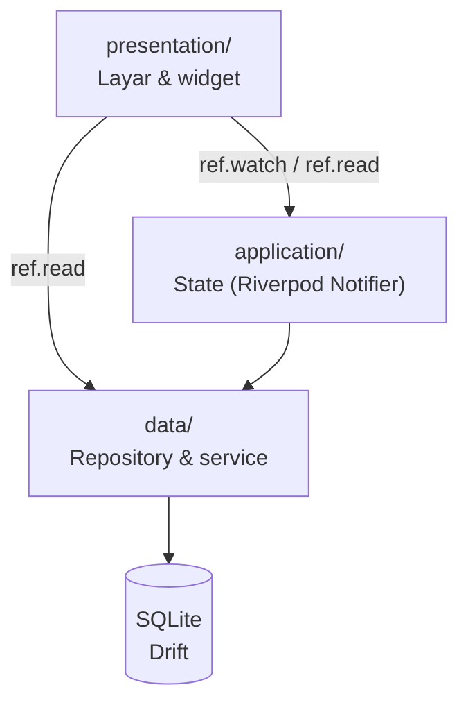
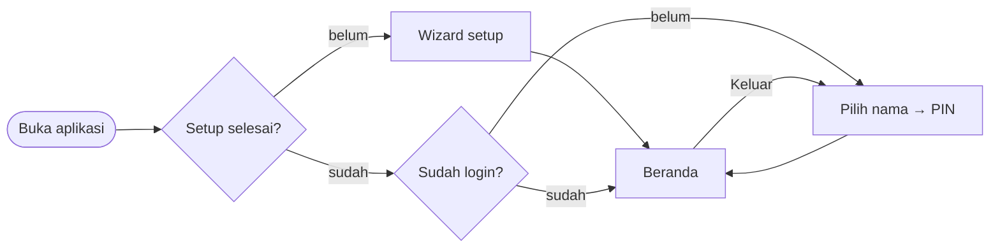

# Arsitektur

## Gambaran besar



- **Offline-first**: semua data ada di database lokal di perangkat (ADR-0001).
- **Riverpod** menyambungkan lapisan. Setiap repository diekspos sebagai `Provider`,
  sehingga di pengujian bisa diganti (database di memori, hasher cepat, jam palsu).

## Struktur folder

```
lib/
├── main.dart                 # Titik masuk: ProviderScope + PosApotekApp
├── app.dart                  # MaterialApp, tema, AppGate (setup → login → beranda)
├── core/                     # Dipakai lintas fitur
│   ├── clock.dart            # Sumber waktu yang bisa diganti di tes
│   ├── database/             # Definisi tabel & AppDatabase (Drift)
│   ├── security/             # PinHasher (PBKDF2-HMAC-SHA256)
│   ├── theme/                # Tema aplikasi
│   └── widgets/              # PinPad, PinSetupFlow, RecoveryCodeView, helper umum
└── features/
    ├── setup/                # Wizard setup awal
    ├── auth/                 # Pengguna, PIN, sesi login, kode pemulihan
    ├── home/                 # Beranda (menu utama)
    └── settings/             # Pengaturan: data apotek, pengguna, ganti PIN
```

Setiap fitur dibagi menjadi `data/` (akses database, aturan bisnis),
`application/` (state aplikasi), dan `presentation/` (tampilan).

## Alur layar



Saat keluar, semua layar yang terbuka ditutup otomatis (`app.dart`).

## Keamanan PIN

- PIN 6 angka; PIN lemah (semua angka sama, berurutan) ditolak.
- Disimpan sebagai **PBKDF2-HMAC-SHA256** (20.000 iterasi, salt acak 16 byte),
  dihitung di isolate terpisah agar UI tidak tersendat.
- **Penguncian**: setiap 5 kali salah, akun dikunci 30 detik, lalu 1, 2, 4 … menit
  (maksimal 15 menit). Status kunci disimpan di database sehingga tidak hilang
  saat aplikasi ditutup.
- **Kode pemulihan** (format `ABCD-EFGH`, tanpa huruf mirip seperti 0/O, 1/I) untuk
  Pemilik yang lupa PIN. Hanya hash-nya yang disimpan; setelah dipakai, kode lama
  hangus dan kode baru diberikan. Kasir yang lupa PIN diatur ulang oleh Pemilik.
- Pemilik aktif terakhir tidak bisa dinonaktifkan.

## Pengujian

```bash
flutter test
```

- `test/core/` — PinHasher (dibandingkan dengan `hashlib` Python sebagai referensi)
- `test/features/` — repository & service dengan SQLite di memori
- `test/app_flow_test.dart` — alur lengkap di UI: setup → beranda → keluar → login

## Kode hasil generate

File `*.g.dart` dibuat oleh Drift. Setelah mengubah tabel:

```bash
dart run build_runner build
```
