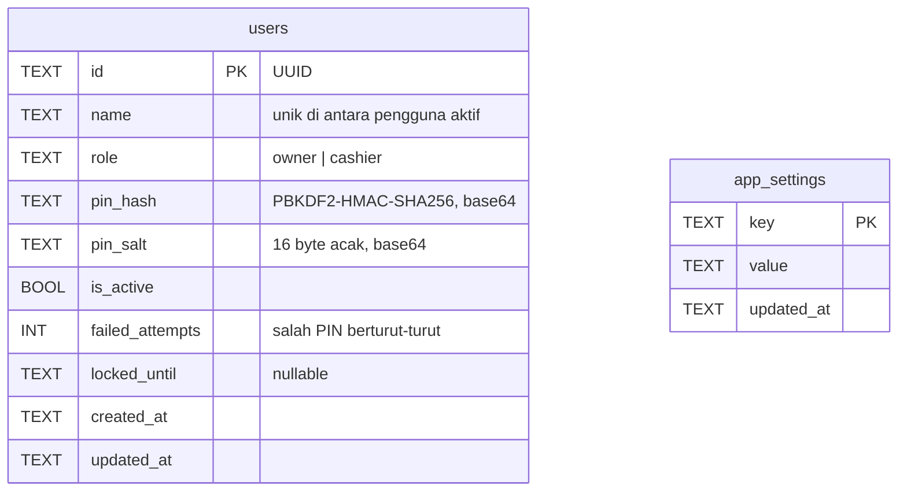

# Database

SQLite lokal melalui [Drift](https://drift.simonbinder.eu/). Definisi tabel ada di
[`lib/core/database/tables.dart`](../lib/core/database/tables.dart).

Konvensi (ADR-0001):

- Primary key berupa **UUID** (teks), agar data dari beberapa perangkat tidak bentrok
  saat sinkronisasi cloud kelak.
- Setiap tabel memiliki `updated_at`.
- Tanggal disimpan sebagai teks **ISO-8601** (lihat `build.yaml`).

Versi skema saat ini: **1**.

## Diagram

Tabel produk, batch, transaksi, dan shift ditambahkan di langkah berikutnya
(lihat [ROADMAP](ROADMAP.md)).

## Kunci `app_settings`

| Kunci | Isi |
|---|---|
| `app.setup_completed` | `true` setelah wizard selesai |
| `store.name` | Nama apotek |
| `store.address` | Alamat |
| `store.phone` | Telepon / WhatsApp |
| `receipt.footer` | Catatan di bawah struk |
| `auth.recovery_hash` | Hash kode pemulihan Pemilik |
| `auth.recovery_salt` | Salt kode pemulihan |

## Migrasi

Setiap perubahan skema setelah aplikasi dipakai di apotek **wajib** menaikkan
`schemaVersion` di `AppDatabase` dan menambahkan langkah migrasi, agar data yang
sudah ada tidak hilang.
