# Database

SQLite lokal melalui [Drift](https://drift.simonbinder.eu/). Definisi tabel ada di
[`lib/core/database/tables.dart`](../lib/core/database/tables.dart).

Konvensi (ADR-0001):

- Primary key berupa **UUID** (teks), agar data dari beberapa perangkat tidak bentrok
  saat sinkronisasi cloud kelak.
- Setiap tabel memiliki `updated_at`.
- Tanggal disimpan sebagai teks **ISO-8601** (lihat `build.yaml`).

Versi skema saat ini: **3**.

## Diagram

```mermaid
erDiagram
    users {
        TEXT id PK "UUID"
        TEXT name "unik di antara pengguna aktif"
        TEXT role "owner | cashier"
        TEXT pin_hash "PBKDF2-HMAC-SHA256, base64"
        TEXT pin_salt "16 byte acak, base64"
        BOOL is_active
        INT failed_attempts "salah PIN berturut-turut"
        TEXT locked_until "nullable"
        TEXT created_at
        TEXT updated_at
    }
    app_settings {
        TEXT key PK
        TEXT value
        TEXT updated_at
    }
    products {
        TEXT id PK "UUID"
        TEXT name
        TEXT generic_name "kandungan, ikut dicari"
        TEXT category
        TEXT drug_class "bebas | bebasTerbatas | keras | narkotikaPsikotropika | nonObat"
        TEXT photo_file "nama file di folder product_photos/"
        INT min_stock "satuan terkecil; 0 = tanpa peringatan"
        INT near_expiry_days "nullable; null = ikut pengaturan umum"
        BOOL is_active "false = diarsipkan"
        TEXT created_at
        TEXT updated_at
    }
    product_units {
        TEXT id PK
        TEXT product_id FK
        TEXT name "Tablet, Strip, Box, ..."
        INT multiplier "isi dalam satuan terkecil; terkecil = 1"
        INT sell_price "rupiah"
        TEXT barcode "unik, nullable"
        TEXT created_at
        TEXT updated_at
    }
    batches {
        TEXT id PK
        TEXT product_id FK
        TEXT batch_number
        TEXT expiry_date "nullable; hari terakhir bulan ED"
        INT quantity "sisa, satuan terkecil"
        REAL cost_per_unit "harga beli per satuan terkecil"
        TEXT received_at
        TEXT created_at
        TEXT updated_at
    }
    stock_movements {
        TEXT id PK
        TEXT product_id FK
        TEXT batch_id FK
        TEXT type "stockIn | sale | adjustment | disposal | saleVoid"
        INT quantity "+ masuk / − keluar"
        TEXT note
        TEXT user_id FK "nullable"
        TEXT sale_id FK "nullable; terisi untuk sale & saleVoid"
        TEXT created_at
        TEXT updated_at
    }
    sales {
        TEXT id PK
        TEXT number "yyMMdd-NNNN, urut per hari"
        TEXT cashier_id FK
        INT subtotal "harga × jumlah, sebelum diskon"
        INT item_discount "jumlah diskon per barang"
        INT discount "diskon total belanja"
        INT total "subtotal − item_discount − discount (tanpa pembulatan)"
        TEXT payment_method "cash | qris"
        INT amount_paid
        INT change
        REAL cost_total "harga beli FEFO; untuk laba"
        TEXT status "completed | voided"
        TEXT void_reason "nullable"
        TEXT voided_by FK "nullable"
        TEXT voided_at "nullable"
        TEXT created_at
        TEXT updated_at
    }
    sale_items {
        TEXT id PK
        TEXT sale_id FK
        TEXT product_id FK
        TEXT unit_id "tanpa FK; satuan bisa dihapus"
        TEXT product_name "salinan saat transaksi"
        TEXT unit_name "salinan saat transaksi"
        INT multiplier
        INT quantity "dalam satuan yang dijual"
        INT list_price "harga normal saat itu"
        INT unit_price "harga dipakai (bisa diubah Pemilik)"
        INT discount
        INT line_total
        REAL cost_total
        TEXT created_at
        TEXT updated_at
    }
    products ||--|{ product_units : "dijual dalam"
    products ||--o{ batches : "stoknya"
    batches ||--o{ stock_movements : "riwayat"
    users ||--o{ stock_movements : "dicatat oleh"
    sales ||--|{ sale_items : "berisi"
    sales ||--o{ stock_movements : "mengurangi stok"
    users ||--o{ sales : "kasir"
```

### Aturan stok (ADR-0007)

- Stok **tidak** disimpan di `products`; stok = jumlah `batches.quantity`.
- Semua jumlah dalam **satuan terkecil** (mis. tablet). `formatStock` menampilkannya
  kembali sebagai "1 Box 2 Strip 5 Tablet".
- Pengurangan stok mengikuti **FEFO**: ED terdekat dulu, batch tanpa ED paling akhir,
  batch **kedaluwarsa tidak pernah diambil**.
- ED disimpan sebagai **hari terakhir bulan** karena kemasan umumnya hanya mencantumkan
  bulan & tahun.
- Stok masuk dengan no. batch & ED yang sama digabung ke batch yang ada; harga beli
  dirata-rata tertimbang.
- Setiap perubahan stok mencatat satu baris `stock_movements`.

### Aturan transaksi

- Satu transaksi disimpan dalam **satu transaksi database**: bila satu barang gagal
  (mis. stok habis), tidak ada yang tersimpan.
- Nama produk, satuan & harga **disalin** ke `sale_items`, jadi riwayat tidak berubah
  walau produk diubah atau diarsipkan.
- Ubah harga & diskon hanya oleh **Pemilik** (diperiksa di `SaleService`, bukan hanya
  di layar).
- Pembatalan (`voidSale`, hanya Pemilik, alasan wajib) mengembalikan stok ke **batch
  asal** lewat gerakan `saleVoid`; transaksi tetap ada dengan status `voided`.

Indeks tambahan: `product_units(product_id)`, `product_units(barcode)` unik,
`batches(product_id, expiry_date)`, `stock_movements(product_id, created_at)`,
`stock_movements(sale_id)`, `sales(created_at)`, `sale_items(sale_id)`.

## Kunci `app_settings`

| Kunci | Isi |
|---|---|
| `app.setup_completed` | `true` setelah wizard selesai |
| `store.name` | Nama apotek |
| `store.address` | Alamat |
| `store.phone` | Telepon / WhatsApp |
| `receipt.footer` | Catatan di bawah struk |
| `auth.recovery_hash` | Hash kode pemulihan Pemilik |
| `auth.recovery_salt` | Salt kode pemulihan |
| `stock.near_expiry_days` | Batas peringatan "hampir ED" dalam hari (bawaan 90) |
| `store.logo_file` | Nama file logo di folder `product_photos/` (ikut backup) |
| `printer.type` | `none` / `bluetooth` / `network` / `android` |
| `printer.bt_address`, `printer.bt_name` | Printer Bluetooth terpilih |
| `printer.host`, `printer.port` | Printer WiFi (port bawaan 9100) |
| `printer.paper` | `mm58` / `mm80` |
| `printer.auto_print` | Cetak otomatis setelah transaksi (bawaan `true`) |
| `receipt.show_logo` | Tampilkan logo di struk (bawaan `true`) |

## Migrasi

Setiap perubahan skema **wajib** menaikkan `schemaVersion` dan menambahkan langkah
migrasi, agar data yang sudah ada di HP tidak hilang. Alurnya:

1. Ubah tabel di `tables.dart`, naikkan `schemaVersion` di `app_database.dart`.
2. `dart run build_runner build`
3. `dart run drift_dev make-migrations` — menyimpan snapshot skema baru di
   `drift_schemas/` dan membuat `app_database.steps.dart` serta tes di `test/drift/`.
4. Tambahkan langkah `fromXToY` di `onUpgrade: stepByStep(...)`.
5. `flutter test test/drift` — memastikan migrasi dari **setiap** versi lama berhasil
   dan data lama tetap utuh.

| Versi | Perubahan |
|---|---|
| 1 | `users`, `app_settings` |
| 2 | `products`, `product_units`, `batches`, `stock_movements` + indeks |
| 3 | `sales`, `sale_items`; `products.near_expiry_days`; `stock_movements.sale_id` |
